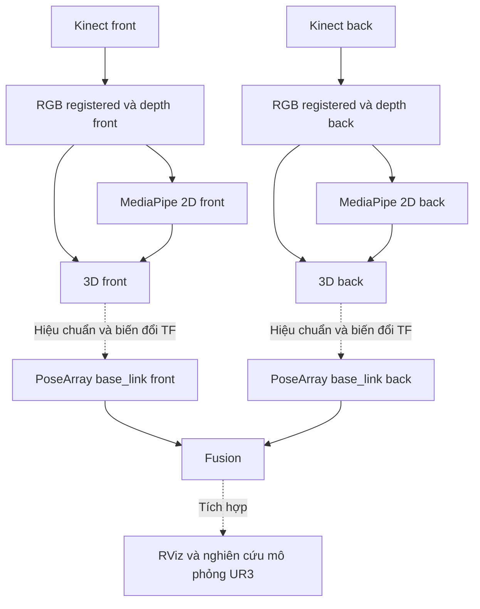

# Kiến trúc

Nét đứt thể hiện khâu tích hợp cần xác minh. Driver đăng ký RGB/depth bằng hiệu chuẩn nội bộ libfreenect2. Node 2D dùng MediaPipe Tasks, mặc định tối đa 6 FPS, một người. Node 3D lọc visibility/presence, lấy median depth lân cận bán kính 2 pixel, khoảng depth mặc định 0.4–4.5 m, loại vùng gián đoạn depth. Phép chiếu ngược: X=(u-cx)Z/fx, Y=(v-cy)Z/fy, Z=depth. Đây là XYZ camera, không phải tọa độ robot.

Fusion mặc định 20 Hz, tuổi dữ liệu tối đa 0.35 s, chênh timestamp tối đa 0.10 s, ngưỡng hợp nhất 0.20 m. Hai điểm gần nhau lấy trung bình, nếu xa ưu tiên front, thiếu front thì lấy back. Không phải fusion trọng số confidence, không có nhận dạng cùng người, không ước lượng TF. Các ngưỡng trên là tham số prototype, không phải khoảng cách an toàn. Không có chức năng dừng robot được chứng nhận.
